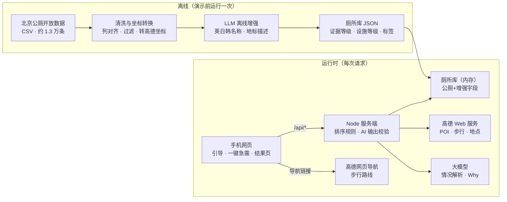

# ReadytoGo｜入境游客如厕助手 PRD v2.0（北京版）

2026-10-08

## 文档信息与变更摘要

v2.0 把产品迁到北京：以北京市政府公厕开放数据作为证据底座，高德补充室内场所厕所与导航；同时加入文化差异设计、AI 情况解析和首页一键急需。v1.2 的诚实原则、降级机制和双语询问卡全部保留。

| 项目 | 内容 |
| --- | --- |
| 状态 | 开发与评审交付稿（北京数据的列对齐、坐标系待实测） |
| 平台 | 手机网页，无需登录 |
| 界面语言 | P0：英文、日文、韩文；P1：阿拉伯文（需右到左排版）等。AI 情况解析接受任意语言输入。地点始终保留中文原名和地址 |
| 首版区域 | 北京东城区、西城区；演示路线暂定：故宫神武门 → 景山 → 南锣鼓巷 → 什刹海，以真实数据结果调整 |
| 数据源 | 北京市公共厕所信息（政府开放数据，约 1.3 万条）+ 高德 POI、步行路线、地点搜索、网页导航 |
| 交付约束 | 从零开发，目标约一天完成可录屏版本；团队人数与工期待定，按第 1 节优先级裁剪 |

**v1.2（上海）→ v2.0（北京）主要变化**

| 维度 | v1.2 上海 | v2.0 北京 |
| --- | --- | --- |
| 坐便证据 | 只有高德 `200303` 一个信号 | 三级：第三卫生间（strong）、无障碍厕位或 `200303`（likely）、其他（unknown） |
| 设施条件 | 无 | Facility level 1–5 星，基于公厕类别、管理间、盥洗室 |
| 文化差异 | 仅英文界面 | 多语界面、按语言/地区设默认偏好、差异化如厕小贴士、多语询问卡 |
| AI 职责 | 多站规划的枚举式建议 | 情况解析（首次引导 + 结果页微调）、个性化“Why this place?” |
| 急需入口 | 选起点 → 选需求 → 搜索，三步 | 首页一个大按钮，使用已保存偏好直接出结果 |
| 规划模式 | P0 | 降为 P1“景点厕所速查” |
| 开放时间 | 高德营业字段 | 政府数据无营业字段，公厕显示 `Hours not listed`；高德室内场所沿用 v1.2 规则 |

## 1. 一句话产品定义与验收目标

帮助入境游客，尤其是需要坐便、带老人或小孩、行动不便的游客，在北京核心区用自己的语言说清情况后，一键找到有官方数据依据的厕所，并看懂每个结果为什么适合自己、哪些信息还没核实。产品不保证到达时一定可用。

**完成标准**

1. **一键急需 P0**：首页大按钮 → 定位或手选起点 → 使用已保存偏好直接出结果 → 打开步行导航。模型接口失败时仍能完成。
2. **情况解析 P0**：用户用任意语言描述情况 → AI 解析为可编辑的偏好标签 → 用户确认后保存。模型失败时，用快捷标签完成同样的设置。
3. **结果页微调 P0**：用户用自然语言修改需求（“近一点”“我女儿也要去”）→ 标签更新 → 结果重新排序，可撤销。
4. **文化差异 P0**：根据语言和地区给出界面语言、默认偏好和小贴士；用户自己的描述优先于地区默认。
5. **真实性**：不把第三卫生间或无障碍信息写成已核实坐便；任何模式都不显示 `Open now`；不编造厕所、设施等级依据或步行时间；AI 只解释数据里已有的事实。

### 不在一天版范围

实时厕位、卫生和厕纸状态；东城、西城以外的区域；室内寻厕导航；轮椅无障碍路线保证；用户登录与评论；照片上传与 AI 识图（P1）；景点厕所速查（P1）；多站规划（P2）；阿拉伯文右到左界面（P1）。

### 开发优先级

按此顺序保证可录屏：① 政府数据清洗入库 → ② 一键急需与结果卡 → ③ 情况解析与偏好保存 → ④ 网页导航与多语询问卡 → ⑤ 文化小贴士与默认偏好 → ⑥ 结果页自然语言微调 → ⑦ AI 生成 “Why this place?”。工期紧时从 ⑦ 往前砍，⑦ 退回规则模板；证据标签、未知状态和 AI 输出校验不能删。

## 2. 用户需求模型与信息口径

用户的需求统一存成一个偏好对象，来源有三种：AI 情况解析、快捷标签、地区默认值。排序只由规则根据这个对象完成，AI 不直接排序。

### 2.1 偏好字段

| 字段 | 取值 | 对结果的影响 |
| --- | --- | --- |
| `seat` | `any` / `prefer_seated` / `require_seated` | 见 v1.2 规则：`prefer` 允许多走 5 分钟换坐便线索；`require` 首选区只放 strong/likely |
| `comfort` | `normal` / `high` | `high` 时，Facility level ≥4 星且最多多走 5 分钟的候选排前 |
| `companions` | `elderly`、`child`、`infant`（可多选） | 优先有第三卫生间或无性别厕位的候选，最多多走 5 分钟 |
| `mobility` | `none` / `limited_walking` / `wheelchair` | `limited_walking` 默认步行上限 10 分钟；`wheelchair` 等同 `require_seated` 且只认无障碍证据，同时提示不保证路线无障碍 |
| `maxWalkMinutes` | `null` / 5 / 10 / 15 | 超出时标 `Long walk`，不隐藏 |
| `tipTopics` | 见 3.3 | 决定推送哪些小贴士 |
| `uiLanguage` | `en` / `ja` / `ko`（P0） | 界面和 AI 解释的语言 |

所有“多走 5 分钟”“上限 10 分钟”都是首版可配置的产品假设，不宣称来自用户研究。

### 2.2 坐便证据（三级）

| 内部状态 | 触发条件 | 用户看到的英文 |
| --- | --- | --- |
| `strong` | 政府数据“第三卫生间”数量 ≥1 | `Family restroom listed · usually has a sitting toilet`；详情：`Official Beijing data lists a family restroom. Design standards include a sitting toilet there. Not checked on site.` |
| `likely` | 政府数据“无障碍厕位”或“无障碍厕所间”为“有”；或高德 `typecode=200303` | `Likely sitting toilet`；详情：`Based on an accessible-stall listing. Not checked on site.` |
| `unknown` | 其他所有情况 | `Sitting toilet unknown`；详情：`No seating information in the data.` |

- 没有 `confirmed` 状态，不显示百分比。
- 名称含“无障碍”但字段或类型不支持时，仍为 `unknown`，名称不能升级证据。
- 政府点与高德点合并为同一厕所时，取较高等级，并同时显示两个来源。
- `strong` 和 `likely` 卡片加礼让提示：`Please give priority to people who need accessible or family facilities.`

### 2.3 设施等级 Facility level（1–5 星）

仅对政府数据中的公厕计算，规则如下，最终限制在 1–5：

| 字段 | 计分 |
| --- | --- |
| 类别 | 一类 3 分，二类 2 分，三类或空 1 分 |
| 管理间 = 有 | +1（有人值守，维护通常更好） |
| 盥洗室 = 有 | +1 |
| 农村公厕 = 是 | −1 |

界面写作 `Facility level ★★★★☆`，说明为 `Based on the official toilet grade and listed facilities. Not a live cleanliness rating.` 这是设施条件，不是实时卫生评分。高德室内场所厕所显示 `Not rated`。“类别”的实际取值需在清洗时先统计分布，再确认计分映射。

### 2.4 过滤口径

- `指标状况` 不是“现有”的记录不进入任何结果。
- `冲洗方式` 不是“水冲”的记录（旱厕等）不进入任何结果；清洗时先统计实际取值，再定白名单。
- 坐标无效且无法可靠修复的记录剔除，并写入清洗日志。

### 2.5 开放信息

政府数据没有开放时间字段，公厕统一显示 `Hours not listed`，不推断 24 小时开放。高德室内场所厕所沿用 v1.2：能解析时显示 `Within listed hours (not verified open)` 或 `Outside listed hours`，否则 `Hours unknown`。任何情况都不显示 `Open now`。

### 2.6 步行信息

沿用 v1.2：只有高德步行算路返回的耗时才写作 `X min walk`；算路失败显示 `About X m away · Map distance only`；都没有时显示 `Walking time unavailable`。超过用户步行上限（未设置时为 15 分钟）标 `Long walk`。

### 2.7 位置与进入信息

- 政府公厕标 `Street public toilet`，同时显示英文地标描述（离线生成，见 6.3）和中文地址。胡同公厕常常藏在巷子里，描述要帮用户找到最后几十米。
- 高德明确返回室内楼层时显示 `Inside venue · Floor L2`，并标 `Entry/access not verified`；没有室内字段时不推断为室外。

### 2.8 坑位数

显示 `Stalls: 4 women · 4 men`（有无性别厕位时加上）。这只是规模参考，不宣称排队时间。

## 3. 文化差异设计

文化差异体现在三层：界面语言、默认偏好、如厕小贴士。原则是语言和地区只决定**默认值和贴士顺序**，用户自己的描述永远优先；界面上不给用户贴文化标签，所有默认值都可一键修改。

### 3.1 语言

- 界面语言按浏览器语言自动选择；用户在情况解析里用什么语言描述，界面就切换到该语言（P0 支持范围内）。
- P0 提供英文、日文、韩文的静态界面文案；AI 解释和情况解析接受并输出任意语言，界面文案超出范围时回退英文。
- 厕所名称、地址始终同时显示中文原文，方便给路人、店员或司机看。

### 3.2 默认偏好（按语言/地区分组）

| 用户语言/地区分组 | 默认 `seat` | 默认 `comfort` | 首次优先推送的贴士 |
| --- | --- | --- | --- |
| 英语及欧洲语言 | `prefer_seated` | `normal` | 自带纸巾、纸巾处理标识、第三卫生间可用 |
| 日语、韩语 | `prefer_seated` | `high` | 智能马桶预期、自带纸巾、商场和酒店概率更高 |
| 阿拉伯语、马来语、印尼语、土耳其语等 | `any` | `normal` | 清洗用水、自带纸巾 |
| 其他或无法判断 | `prefer_seated` | `normal` | 通用贴士 |

这些分组是首版产品假设，用于给出合理起点，不代表对任何群体的判断。用户在情况解析里提到的具体情况（带老人、膝盖不好、坐轮椅）一律覆盖地区默认。

### 3.3 如厕小贴士库

| 贴士 ID | 内容（英文要点） | 触发条件 |
| --- | --- | --- |
| `bring_tissue` | Many public toilets have no paper. Carry tissues. | 所有用户 |
| `paper_sign` | Some older toilets ask you to put paper in the bin. Follow the sign. | 所有用户 |
| `family_restroom_ok` | Family and accessible restrooms often have sitting toilets. Use them considerately and give priority to those who need them. | `seat` 不是 `any` |
| `washing_water` | Bidet sprayers are rare in public toilets. Consider carrying a small water bottle. | 对应地区分组，或用户提到清洗 |
| `smart_toilet` | Heated or bidet toilets are uncommon. High-end malls and hotels are your best bet. | 日语、韩语分组，或用户提到 |
| `squat_howto` | 首次使用蹲厕的图解卡片，可以做得幽默一点 | 所有用户可选查看 |
| `hutong_toilets` | Hutong residents share public toilets. Look for the 公共厕所 sign. | 起点在胡同片区 |
| `venue_restrooms` | Large malls usually have public restrooms. In hotels or cafés, ask politely with the Ask staff card. | 所有用户 |

“北京街头公厕一般免费”可作为补充贴士，上线前核实措辞。

### 3.4 多语询问卡

沿用 v1.2 的规则模板，不调用 AI。上半部分给现场人员看中文，下半部分用用户的界面语言。在 v1.2 三个问题之外新增两条：

| 场景 | 中文（给现场人员看） | 英文（给游客看，日韩同理） |
| --- | --- | --- |
| 借用洗手间 | 请问可以借用一下洗手间吗？ | May I use your restroom, please? |
| 问路 | 请问附近哪里有洗手间？ | Is there a restroom nearby? |
| 坐便未确认 | 请问这个洗手间有坐便马桶吗？ | Does this restroom have a sitting toilet? |
| 开放不确定 | 请问这个洗手间现在开放吗？ | Is this restroom open now? |
| 进入不确定 | 请问可以进去使用这个洗手间吗？入口在哪里？ | May I enter to use this restroom? Where is the entrance? |

卡片顶部放所选厕所的中文名称和地址，可复制；询问结果不会自动变成“已核实”数据。

## 4. AI 在产品中的确切职责

AI 做两件用户能直接感知的事：把任意语言的情况描述变成结构化偏好，以及用用户的语言解释“为什么推荐这个厕所”。数据、证据等级、步行时间和排序全部由规则决定，AI 不新增任何事实。

### 4.1 情况解析（Situation parsing）

**触点**

| 触点 | 位置 | 模式 | 优先级 |
| --- | --- | --- | --- |
| 首次引导 | `/welcome` 的 “What's your situation?” | `onboarding`：输出完整偏好 | P0 |
| 结果页微调 | 结果页底部 “Need something different?” | `refine`：输出相对当前偏好的变化 | P0 |
| 首页搜索框 | 首页次要入口 | 同 `onboarding` | P1 |

一键急需按钮**永远不要求打字**，直接使用已保存的偏好。

**输入**：用户原文（≤300 字符，任意语言）；`refine` 模式另附当前偏好对象。用户原文在提示词里作为数据处理，不能改变系统行为。

**输出（结构化 JSON，示例）：**

```json
{
  "detectedLanguage": "en",
  "seat": "require_seated",
  "comfort": "normal",
  "companions": ["elderly"],
  "mobility": "limited_walking",
  "maxWalkMinutes": 10,
  "tipTopics": ["family_restroom_ok"],
  "clarifyingQuestion": null,
  "unparsedNeeds": []
}
```

对应输入：“Traveling with my 70-year-old mom, she has bad knees and can't squat.”

**规则与校验**

- 所有字段只接受第 2.1 节的枚举值；越界字段丢弃，不报错给用户。
- 无法映射的需求（如“要有智能马桶”）写入 `unparsedNeeds`，界面诚实回复 `We can't filter for this yet` 并推送相关贴士。
- 描述含糊时，最多返回一个 `clarifyingQuestion`，附 2–4 个选项。
- 解析结果先以标签呈现：`We understood: Sitting toilet · With elderly · Short walk`，用户点 `Confirm` 才保存（首次引导）；微调模式立即生效并提供 `Undo`。
- 不提供医疗建议；提到疾病或紧急健康状况时，只做偏好映射，并显示紧急求助提示。
- 超时（建议 5 秒）或校验失败时，显示快捷标签让用户手动设置，流程不中断。

### 4.2 个性化解释 “Why this place?”

结果出来后，服务端把前 3 个候选的结构化事实和用户偏好交给模型，模型返回：

```json
{
  "poiId": "BJ-060301A",
  "reasonCodes": ["family_restroom", "fits_companion"],
  "caveatCodes": ["seat_unverified", "hours_not_listed"],
  "sentence": "Has a family restroom, which usually means a sitting toilet — easier for your mom."
}
```

- 允许的 `reasonCodes`：`family_restroom`、`accessible_stall`、`short_walk`、`high_facility_level`、`staffed`、`many_stalls`、`venue_indoor`、`fits_companion`。
- 允许的 `caveatCodes`：`seat_unverified`、`hours_not_listed`、`hours_unknown`、`walk_time_unknown`、`entry_unverified`、`long_walk`。
- 服务端校验：`poiId` 必须属于本次结果；每个理由码必须有对应数据（如 `family_restroom` 要求第三卫生间 ≥1）；句子不得出现 open now、clean、guaranteed 等未经证实的说法；句中数字必须与步行时间或距离一致；长度 ≤25 个英文单词或等长。
- 任一校验失败或超时，用理由码对应的规则模板句替代。解释异步加载，不阻塞结果卡。

### 4.3 AI 不做的事

不产生、修改或删除厕所；不改变证据等级、设施等级、步行时间和排序；不判断实时开放、卫生或厕纸；不在多语询问卡里生成文字（询问卡是固定模板）。

### 4.4 为什么这里需要 AI

规则表单只能处理勾选项，而游客的真实需求常常是一句复合描述，并且用的是各自的母语，例如“妈妈膝盖不好”“带着三岁的女儿”。AI 负责理解这句话并映射到可验证的偏好，再用用户的语言把数据证据讲清楚。规则负责所有事实和安全边界，两者分工明确。

## 5. 页面、行为与异常状态

用户最短路径是：首次打开说一句情况（可跳过）→ 之后每次都只按一个大按钮。

### 5.1 首次引导 `/welcome`（可跳过）

- 标题 `What's your situation?`；副标题 `Tell us what you need from a restroom — in any language.`
- 输入框占位例句：`e.g. "Traveling with my mom, she can't squat" / "I have a toddler with me"`。
- 输入框下方是快捷标签：`Need a sitting toilet`、`With kids`、`With elderly`、`Wheelchair user`、`Just the nearest`。点标签等同于手动设置，不调用 AI。
- 提交后显示解析出的标签和 `Confirm` / `Edit`；确认后保存到浏览器本地存储。本地存储不可用时只在当前会话生效，不报错。
- 跳过时使用第 3.2 节的地区默认偏好。
- 页面底部说明定位用途：`We only use your location when you tap Find.`

### 5.2 首页 `/`

- 屏幕中央、拇指可达处放超大按钮 `I need a restroom NOW`。首次使用、没有任何偏好时也能直接点，使用地区默认偏好。
- 按钮下方显示当前偏好：`Using: Sitting toilet · With elderly · ≤10 min walk · Change`。
- 次要入口：`Choose a place instead`（手选起点）、`Restroom tips`；P1 增加自然语言搜索框。
- 页脚：`Facility details come from Beijing open data and map data, and may need on-site confirmation.`

**点击大按钮后的行为**

1. 请求浏览器定位（首次会触发系统授权弹窗）。
2. 成功 → 直接进入结果页，起点标 `Your location (GPS)`。
3. 拒绝、超时或浏览器不支持 → 显示对应原因和手选起点；不得把演示地点伪装成 GPS 位置。
4. 位置在东城、西城以外 → 显示 `ReadytoGo currently covers central Beijing (Dongcheng & Xicheng).`，并提供手选起点。

**手选起点**沿用 v1.2：关键词调用高德地点搜索，用户必须点选一个真实 POI；提供英文快捷选点 `Forbidden City North Gate / 故宫神武门`、`Jingshan Park / 景山公园`、`Nanluoguxiang / 南锣鼓巷`、`Shichahai / 什刹海`、`Wangfujing / 王府井`。英文别名只用于发起中文搜索。

### 5.3 结果页 `/results`

顶部显示起点来源、当前偏好标签和 `Change`。首屏是 **1 张首选大卡片 + 2 张备选**，`Show more` 展开其余。

**卡片内容**

- 用户语言的名称（离线生成）+ 中文名称 + 中文地址（可复制）+ 英文地标描述
- 步行时间或地图距离；超出上限标 `Long walk`
- 坐便证据徽标、Facility level 星级（仅政府公厕）、开放信息、坑位数
- 标签：`Family restroom`、`Accessible`、`Staffed`；室内场所显示楼层和 `Entry/access not verified`
- `Why this place?`（AI 生成或规则模板）、`Navigate`、`Ask staff`
- 来源行：`Source: Beijing Open Data · updated [文件更新日期]` 或 `Source: Amap POI · retrieved [取数时间]`

**不确定性的呈现**：卡片正面用图标和颜色表达，有证据为绿色勾，未知为灰色问号；完整说明折叠在 `Details` 里，避免满屏免责声明。礼让提示放在 strong/likely 卡片的详情首行。

**`require_seated` 分区（沿用 v1.2）**

1. `Likely sitting toilet`：strong 与 likely，strong 排前
2. `Unverified alternatives`：unknown，明确不代表满足坐便要求
3. `Outside listed hours`：仅高德场所厕所可能出现，默认折叠

**搜索半径**：北京核心区公厕密度高，默认 1 公里。`require_seated` 首选区为空时自动扩大一次到 2 公里，并标 `Search expanded for sitting-toilet evidence`；其他需求通过 `Expand search` 手动扩大。空态和失败文案沿用 v1.2：区分覆盖完整、覆盖受限和请求失败，不宣称区域内客观没有厕所。

**底部微调条**：`Need something different?` 输入后调用情况解析的 `refine` 模式，标签更新并提供 `Undo`，前端重新排序；只有半径变化时才重新查询。

**导航**：沿用 v1.2 的高德网页步行路线 URI（`callnative=0`），可另设 `Open in Amap app`。

### 5.4 询问卡 `Ask staff`

卡片缺少坐便、开放或进入信息时显示入口；内容按第 3.4 节模板，最多 3 条问题，另加“借用洗手间”一条。

### 5.5 小贴士 `/tips`

按第 3.3 节触发条件排序；首次进入结果页时，在顶部推送 1 条最相关的贴士，可关闭。蹲厕图解卡片放在这里。

### 5.6 P1：景点厕所速查 `/spots`

为 5–8 个热门景点预先算好周边最佳的 3 个厕所（分别按三种 `seat` 偏好），供携程行程页、景点详情页直接嵌入。复用同一排序逻辑，不新增数据源。

## 6. 地图数据处理与排序

政府公厕数据在演示前离线清洗、增强一次，服务端启动时载入内存；高德只在运行时补充室内场所厕所、算步行路线和导航。

### 6.1 北京公厕数据获取

- 数据页面：[北京市公共厕所信息](https://data.beijing.gov.cn/publish/bjdata/zyml/wnkfsj/eb2b9eb72f1b446a9525d4f63bfe0f3e.htm)
- 接口：`https://data.beijing.gov.cn/cms/web/bjdata/api/userApply.jsp?id=<文件编号>&key=<个人唯一标识码>`
- 文件编号：CSV 为 `13f1c2448d104dff91b5b4d0ba02eddc34281`（**首选**，便于解析）；XLSX 为 `82e92f2f36d648efa6887880502e37c534281`
- `key`：登录数据平台后在“用户中心 → 唯一标识码”获取，只放服务端环境变量 `BJDATA_KEY`，不进仓库、网页或录屏
- 返回：`id`（文件编号）、`name`（数据名称）、`update`（文件更新时间）、`address`（文件获取地址）
- 流程：调用接口 → 从 `address` 下载文件 → 保存原始文件和 `update` 时间 → 运行清洗脚本。需实测 `address` 链接是否会过期。
- `update` 时间显示在卡片来源行；数据非实时，演示前手动刷新一次即可。

### 6.2 清洗规则

1. **列对齐**：原表是多行合并表头，“地址（GPS 信息）”下含名称、经度、纬度，“坑位数”下含男、女、无性别、第三卫生间。按列位置建立映射后，用已知的 3 行样例（大庞村西公厕等）写对齐测试，确认“有无障碍设施 / 无障碍厕所间 / 全部实现无障碍 / 无障碍厕位 / 管理间 / 盥洗室”没有错位。
2. **空值标准化**：`/` 和空白转为 `null`；“有/无”“是”转为布尔值；坑位数转为整数。
3. **取值统计**：先输出“类别”“冲洗方式”“指标状况”的取值分布，再确定第 2.3、2.4 节的映射和白名单。
4. **过滤**：只保留“指标状况 = 现有”且“冲洗方式 = 水冲”的记录。
5. **坐标校验**：北京范围约为经度 115.4–117.6、纬度 39.4–41.1。明显缺位的经度（如样例中的 `16.7088`）补为 `116.7088`，前提是修复后落在该记录所属区县范围内；否则剔除并写入日志。
6. **坐标系确认**：在东城、西城挑 20 个已知公厕，同时叠加到高德地图和卫星图上比对。若偏移符合 WGS-84 与高德坐标之间的系统偏差，批量调用高德坐标转换（`coordsys=gps`）；若是百度坐标则用 `coordsys=baidu`。同时保存原始坐标和高德坐标。
7. **去重**：按“厕所编号”去重。
8. **区域**：P0 只载入东城区、西城区；全量数据保留，供后续扩展。

### 6.3 离线增强（一次性批处理，结果缓存为 JSON）

| 生成字段 | 方法 | 说明 |
| --- | --- | --- |
| `nameEn` / `nameJa` / `nameKo` | LLM 翻译名称 | 只翻译，不增加名称和地址里没有的信息 |
| `landmarkEn` 等 | LLM 根据名称和地址生成地标描述 | 例：`West of Dongfang Weiye Furniture, Dapang Village` |
| `seatEvidence` | 规则，见 2.2 | strong / likely / unknown |
| `facilityLevel` | 规则，见 2.3 | 1–5，附计分依据 |
| `tags` | 规则 | family、accessible、staffed、washroom |

随机抽 30 条翻译和地标描述做人工检查，记录问题和修正率。

### 6.4 高德补充

- 运行时以起点为中心查询高德 `200300`（公共厕所）与 `200303`（无障碍厕所），请求 `show_fields=business,indoor`。沿用 v1.2 的冒烟发现：按返回 `typecode` 精确过滤，排除 `200304` 母婴室；名称含“无障碍”不升级；`count` 只是本页条数，翻页规则与覆盖状态不变。
- **合并规则**：高德点与某个政府公厕距离 30 米以内且名称相近，视为同一厕所，证据取较高等级，政府数据为主记录；否则作为独立候选（通常是商场、景区内的室内厕所）。
- 北京需重新做三站冒烟：故宫神武门、南锣鼓巷、什刹海，记录 `typecode` 分布、室内楼层、营业字段有值比例和步行接口返回。

### 6.5 查询

1. 政府数据在内存中按距离筛选，默认半径 1 公里（东城、西城数据量预计在千条级，直接计算距离即可，不需要空间数据库）。政府数据是全量清单，覆盖状态记为 `complete`，但措辞仍为“官方清单中未找到”，不宣称客观没有。
2. 同时查询高德补充点，覆盖状态按 v1.2 规则判断。
3. 合并、去重、过滤后按需求分组算步行路线：`require_seated` 先算 strong/likely，再算少量 unknown；其他需求优先最近候选。每组最多约 8 个，限并发、设超时；失败的卡片回退为地图距离。

### 6.6 排序

先过滤，再分区，最后按以下优先级逐层比较，相同时按步行时间、地图距离、ID 稳定排序：

1. `seat` 要求（`require` 时只有 strong/likely 进入首选区；`prefer` 时 5 分钟容忍规则）
2. 同行人（有 `companions` 时，第三卫生间或无性别厕位在 5 分钟容忍内排前）
3. 设施条件（`comfort = high` 时，Facility level ≥4 在 5 分钟容忍内排前）
4. 步行时间升序；无步行时间的排在有步行时间的之后

所有容忍值和阈值放在配置文件中。“为什么排在前面”由排序规则产生理由码，供第 4.2 节 AI 解释使用。

## 7. 建议架构与接口契约

沿用 v1.2 的技术栈：React + TypeScript + Vite 手机网页，Node.js 服务端代理；无需登录和数据库。政府数据离线处理成 JSON，服务端启动时载入内存。



BJDATA_KEY、AMAP_KEY、LLM_KEY 只放服务端环境变量。政府公厕结果只依赖本地数据，所以高德或模型失败都不会让结果页变空。

| 接口 | 必要输入 | 返回与失败行为 |
| --- | --- | --- |
| `GET /api/health` | 无 | 服务状态、政府数据是否载入及更新日期、高德与模型是否已配置（布尔值，不返回密钥） |
| `POST /api/situation/parse` | `text`（≤300 字符）、`mode`（`onboarding` / `refine`）；`refine` 附 `currentPrefs` | 校验后的偏好或变化、标签文案、可选 `clarifyingQuestion`；失败返回 `status=fallback`，前端显示快捷标签 |
| `GET /api/places?q=` | 北京地点关键词；英文别名先映射为中文 | 最多约 10 个真实高德地点；无结果返回空数组，不生成虚构坐标 |
| `GET /api/restrooms` | `lng`、`lat`、`coordSystem`（`wgs84` / `amap`）、`prefs`（编码后的偏好）、`expanded` | 分区候选、`coverageStatus`、`radiusMeters`、`fetchedAt`、`govDataUpdatedAt`、`amapStatus`；政府结果始终返回，高德失败单独标记 |
| `POST /api/why` | 偏好、本次结果前 3 个候选 ID | 每个候选校验后的理由码与句子，或模板句 |
| `GET /api/tips` | `lang`、`prefs` | 排好序的贴士 ID 与文案 |

**候选对象**（以样例行为例，坐标与步行数值为示意）：

```json
{
  "id": "BJ-060301A",
  "sources": ["beijing_open_data"],
  "toiletCode": "060301A",
  "nameZh": "大庞村西公厕",
  "nameEn": "Dapang Village West Public Toilet",
  "landmarkEn": "West of Dongfang Weiye Furniture, Dapang Village",
  "addressZh": "通州区宋庄镇大庞村东方伟业家具西",
  "district": "通州区",
  "location": { "lng": 116.7088, "lat": 39.99546, "system": "amap" },
  "seatEvidence": "strong",
  "seatBasis": ["third_restroom_count:1"],
  "facilityLevel": 1,
  "facilityBasis": ["grade:三类", "staffed:true", "rural:true"],
  "tags": ["family", "staffed"],
  "stalls": { "male": 4, "female": 4, "unisex": 0, "thirdRestroom": 1 },
  "isIndoor": false,
  "hoursStatus": "not_listed",
  "walkMinutes": 8,
  "distanceMeters": 620,
  "distanceKind": "walk_route",
  "govDataUpdatedAt": "<文件 update 字段>",
  "navWebUrl": "https://uri.amap.com/navigation?..."
}
```

- 高德来源的候选额外带 `typecode`、`indoorFloor`、`entryStatus`、`listedHoursText`、`hoursStatusNow`，口径同 v1.2。
- `walkMinutes` 为 `null` 时前端不得自行换算；`isIndoor` 未知时为 `null`。
- `coordSystem=wgs84` 的浏览器坐标在服务端转换为高德坐标，`amap` 坐标不重复转换。
- 偏好只存在用户浏览器本地；定位坐标不写入持久日志。

## 8. 加载、失败和演示备用数据

政府数据是本地离线文件，任何外部接口失败时，产品都至少能给出官方公厕结果。

| 环节 | 正常 | 失败时 |
| --- | --- | --- |
| 情况解析 | 约 2–5 秒返回标签 | 超时或校验失败 → 显示快捷标签手动设置，不阻塞流程 |
| 政府公厕查询 | 本地计算，即时返回 | 文件缺失属于部署错误，启动时自检报错 |
| 高德补充点 | 与政府结果合并 | 失败 → 只显示政府公厕，顶部提示 `Venue restrooms (malls, hotels) unavailable right now` |
| 步行算路 | 每张卡片显示分钟数 | 个别失败 → 该卡片回退为地图距离，其余照常 |
| `Why this place?` | 异步出现在卡片上 | 失败 → 规则模板句，不清空卡片 |
| 地点搜索 | 返回真实 POI | 无结果 / 失败分别提示，失败可重试，不把文字当已确认地点 |
| 定位 | 显示 GPS 起点 | 拒绝、超时、不支持分别提示，转手选，不伪装 GPS |

- `require_seated` 首轮无首选结果时，先渲染已有的 unknown 备选和 `Searching a wider area...`，再自动扩大，不让扩大搜索挡住第一批结果。
- 录屏时若高德异常，可回放开发期间保存的真实高德响应，页面显著标 `Historical Amap sample · captured [time]`，作品说明同步披露。不得用编造的 POI 冒充实时数据。
- 浏览器定位需要安全上下文（HTTPS 或 localhost）；用电脑模拟手机录屏时，起点必须显示为手选。

## 9. 开发安排与验收

数据清洗是所有功能的前提，必须第一个完成；之后前端、AI、高德三条线可以并行。人数和工期确定后再给每步分配人和时间。

| 顺序 | 任务 | 通过条件 |
| --- | --- | --- |
| 1 | 获取北京数据、列对齐、取值统计、坐标系确认与转换 | 3 行样例对齐测试通过；20 个已知公厕叠图无明显偏移；东城、西城记录数和剔除数有日志 |
| 2 | 离线增强：英文/日文/韩文名称、地标描述、证据等级、设施等级 | 30 条抽检记录在案；strong/likely/unknown 分布有统计 |
| 3 | 北京三站高德冒烟、步行接口、网页导航真机测试 | 记录真实 POI、`typecode`、室内与营业字段、步行耗时；导航链接在录屏设备可打开 |
| 4 | 首页大按钮、定位与手选起点、结果页与卡片、分区排序 | 三种 `seat` 需求的分区正确；较远的 strong 候选不被隐藏；可导航 |
| 5 | 情况解析（首次引导 + 结果页微调）与偏好保存 | 示例输入解析正确；超时回退快捷标签；`Undo` 可用 |
| 6 | 文化默认值、小贴士、多语询问卡、日韩界面文案 | 切换语言后默认值与贴士顺序变化；询问卡中文与所选厕所一致 |
| 7 | AI “Why this place?” 与校验 | 只引用真实字段；越界输出回退模板 |
| 8 | 手机尺寸检查、对照素材、录屏 | 完整录到第 10 节脚本 |

### 必过验收用例

1. 样例行“大庞村西公厕”的经度 `16.7088` 被修复为 `116.7088` 或被剔除并记日志，不会以错误坐标出现在地图上。
2. 旱厕和“指标状况”非“现有”的记录不出现在任何结果中。
3. 第三卫生间 ≥1 的公厕显示 strong；只有无障碍厕位的显示 likely；名称含“无障碍”但字段不支持的显示 unknown。
4. `require_seated` 下 unknown 绝不进入首选区；1 公里内无首选时自动扩到 2 公里，仍无时显示诚实空态和未核实备选。
5. 拒绝定位后，手选“南锣鼓巷”仍能完成急需流程，起点不显示为 GPS。
6. 首次使用直接点大按钮，能用地区默认偏好出结果；偏好标签显示在按钮下方。
7. 输入“Traveling with my 70-year-old mom, she can't squat”，解析为 `require_seated` + `elderly`，用户确认后保存；刷新页面后偏好仍在（本地存储可用时）。
8. 输入日文情况描述，界面切换为日文，解析结果正确。
9. 结果页输入“closer please”，偏好变化可见并可撤销，排序随之变化。
10. 模型超时、返回非法枚举或不存在的 `poiId` 时，页面使用快捷标签或模板句，不显示模型原文。
11. “Why this place?” 不出现 open now、clean、guaranteed 等未证实说法，数字与卡片一致。
12. 高德请求失败时仍显示政府公厕结果和提示条；步行算路失败的卡片只显示地图距离。
13. 询问卡中文内容与所选厕所和缺失信息对应，不调用模型，不改变证据等级。
14. 卡片来源行显示政府数据文件的更新日期或高德取数时间。

测试记录除通过与否外，还要记下首次出结果、AI 标签出现、“Why” 出现的实际耗时；未实测前不写“秒开”。

## 10. 演示脚本与交付物

视频按“痛点 → 说一句话 → 一键找到 → 需求变了结果跟着变”组织，全程使用真实数据，不逐页朗读功能。

1. **痛点开场（约 15 秒）**：游客站在南锣鼓巷胡同里，普通地图显示附近有“公共厕所”，但不知道是不是蹲坑、能不能用。
2. **说一句话**：首次打开，用英文（或日文）输入“Traveling with my 70-year-old mom, she has bad knees and can't squat.”，展示 AI 解析出的标签和确认；界面语言与小贴士随之变化。
3. **一键找到**：回到首页点大按钮（起点如实显示为手选“南锣鼓巷”）。展示最近的公厕为什么只在未核实备选里，而首选是稍远但有第三卫生间的公厕，“Why this place?” 说明原因；点导航。
4. **需求变了**：在结果页底部输入“My daughter needs to go too, somewhere nicer please”，标签增加同行人与设施要求，排序变化。
5. **现场核实**：打开询问卡，展示中文问题和厕所地址，说明产品如何帮游客跨过语言障碍。
6. **收尾**：数据来自北京政府开放数据与高德；展示落地设想，即嵌入携程行程页的景点厕所速查（P1 原型图即可）。

录屏前要找到并记录两个真实情境：① 最近的公厕是 unknown，稍远处有 strong；② 需求改变后首选确实变化。记录 POI ID 或厕所编号、证据字段、步行耗时和取数时间。如果演示路线不支持，换真实地点，不改数据。

**开发交付**：可运行网页与服务端、`.env.example`（只含变量名）、README 启动和录屏步骤、数据清洗脚本与日志、北京三站高德冒烟记录、上述验收用例的检查结果。

## 11. 评审问题与证据口径

| 评审可能问 | 回答与应展示的证据 | 不可夸大为 |
| --- | --- | --- |
| 痛点真实吗？ | 入境游客在[公开旅行讨论](https://www.reddit.com/r/travelchina/comments/1u7dl8v/what_was_genuinely_hard_about_traveling_in_china/)中反复提到蹲便与厕纸问题；用胡同场景说明“找到厕所”不等于“能用” | 定性观察，不是发生率调查 |
| 高德、百度已经能找厕所，区别在哪？ | 外国游客很少用国内地图；更重要的是，现有地图不回答“有没有坐便、条件如何、适不适合我”。产品把官方设施字段变成证据，并按个人情况排序 | 不宣称拥有实时坐便或开放数据 |
| 为什么用政府数据？ | 官方全量清单，含第三卫生间、无障碍、类别、管理间等地图没有的字段；1.3 万条可直接调用 | 不宣称数据实时，卡片显示文件更新日期 |
| 第三卫生间就有坐便，可信吗？ | 国家旅游局关于第三卫生间的通知要求其内部包括成人坐便位等设施（[杭州网报道](https://hznews.hangzhou.com.cn/chengshi/content/2017-02/07/content_6458700_0.htm)）；2016 版《城市公共厕所设计标准》要求一类固定式公厕设置第三卫生间（[大河报报道](https://news.qq.com/rain/a/20260506A06SKF00)）。卡片同时写明“未现场核实” | 同一报道也提到有的无障碍间被挪作他用或损坏，因此不给“已确认”或百分比 |
| 文化差异会不会变成刻板印象？ | 地区只决定默认值和贴士顺序，界面不给用户贴标签；用户一句话描述即可覆盖；所有默认值可一键修改 | 不宣称默认值来自用户研究 |
| 为什么要用 AI？ | 现场演示：一句母语描述被理解为可验证的偏好；需求变化后结果随之变化；解释用用户的语言说清证据。事实与排序由规则保证 | 不把翻译或单次模型调用包装为技术突破 |
| 怎么接入携程？ | 景点厕所速查可嵌入行程页和景点详情页；情况描述可成为携程用户画像的一部分；政府数据和高德均有正式接口 | 不宣称已与携程或政府系统对接 |
| 一天真的做出来了吗？ | 视频走通主流程；附清洗日志、冒烟记录、验收清单 | 不把静态图或历史样本说成实时功能 |

**最低演示证据包**：一张小表，记录演示所用起点、厕所编号或 POI ID、证据字段、步行耗时、取数时间，以及产品据此显示的标签和排序。

## 12. 开发参考

- [北京市公共厕所信息（北京市公共数据开放平台）](https://data.beijing.gov.cn/publish/bjdata/zyml/wnkfsj/eb2b9eb72f1b446a9525d4f63bfe0f3e.htm)：数据说明、登录与唯一标识码
- [高德 POI 搜索 2.0](https://lbs.amap.com/api/webservice/guide/api-advanced/newpoisearch)：周边搜索、地点搜索、`business`/`indoor` 字段
- [高德路径规划 2.0](https://lbs.amap.com/api/webservice/guide/api/newroute)：步行路线与耗时
- [高德路线 URI](https://lbs.amap.com/api/uri-api/guide/travel/route)：`mode=walk`，网页打开用 `callnative=0`
- [高德坐标转换](https://lbs.amap.com/api/webservice/guide/api/convert)：`coordsys=gps` / `baidu` 转高德坐标
- [高德 POI 分类表](https://lbs.amap.com/api/webservice/download)：上线前核验 `200300`、`200303`、`200304`
- [北京无障碍相关规范（v1.2 引用）](https://ghzrzyw.beijing.gov.cn/biaozhunguanli/bzzl/202112/P020211228345970190464.pdf)
- [第三卫生间内部设施要求（杭州网，2017）](https://hznews.hangzhou.com.cn/chengshi/content/2017-02/07/content_6458700_0.htm)
- [2016 版《城市公共厕所设计标准》对第三卫生间的设置要求（大河报，2026）](https://news.qq.com/rain/a/20260506A06SKF00)

提交前把所有链接再打开核对一遍，尤其是 v1.2 沿用的旅行讨论链接。
