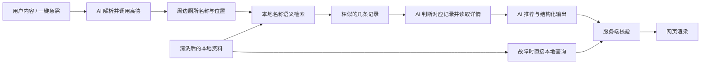

# 数据处理与接口

实现政府数据清洗、高德搜索、本地名称检索、详情查询、坐标、接口或导航时，读取本文。返回 [PRD 总入口](../ReadytoGo-PRD-v2.0-Beijing.md)。

## 数据来源

- 高德是正常查询流程的周边厕所来源，提供名称、位置、POI ID、可用营业/室内字段以及路线能力。
- [本地 CSV](../../data/BJ-ToiletInfo.csv)提供政府厕所名称、编号、地址、坐标与设施资料，经清洗后用于名称语义检索和详情读取；也是故障回退的基础列表来源。
- 现有 CSV 为 GB18030 编码、多行表头，包含十进制度、度分秒和个别经纬互换；它目前是输入文件，不是已实现的查询服务。
- CSV 没有高德 POI ID。高德候选与本地记录通过[名称召回与 AI 判断](ai.md#本地记录关联)建立对应。

## 数据获取与清洗

1. **保存来源**：保留原始 CSV、文件更新时间与获取方式。需要刷新时使用北京市公共厕所数据接口，密钥只在服务端配置。
2. **核对表头**：建立名称、编号、地址、坐标、坑位和设施字段映射。用 3 行样例检查多行表头及无障碍、管理间、盥洗室等列的对齐。
3. **标准化**：空白与 `/` 转为缺失值，设施有无转为布尔值，坑位数转为整数；保留原始字段以便追溯。
4. **统计与过滤**：先输出类别、冲洗方式、指标状况的取值分布，再按[过滤规则](rules.md#记录过滤)确定映射和白名单。
5. **清洗坐标**：解析十进制度、度分秒和方向标记，核对经纬互换与缺位。只有可可靠修复的记录才改正，其余剔除并记日志。
6. **统一坐标系**：选择 20 个已知公厕叠图检查，确定原始坐标系，转换到高德坐标并保留原值。
7. **记录与区域**：按政府厕所编号去重，运行时使用北京东城、西城记录；原始全量文件保留用于审计。
8. **增强与索引**：生成英日韩名称和地标描述、规则证据与设施等级，并建立本地名称语义检索与详情读取能力。翻译仅使用已有名称和地址信息，抽取 30 条核对。

本地查询的存储介质、索引和检索算法由实施确定；完成条件是能按名称召回相似记录、按编号取得详情，并在故障时按位置取得本地候选。

## 高德搜索

- AI 根据起点调用周边搜索，查询 `200300` 公共厕所与 `200303` 无障碍厕所，按返回类型精确过滤，排除 `200304` 母婴室等非目标类型。
- 请求营业与室内字段，例如 `show_fields=business,indoor`；缺失字段保持未知。
- 高德内部按 POI ID 去重。缺 ID 时使用名称、近似坐标和楼层组合，保留同一场所不同楼层记录。
- 按需翻页；`count` 是当前页记录数，不能据此判断整个区域只有这些结果。只有确认到末页才为完整，因页数、配额或查询上限停止时记为受限。
- 故宫神武门、南锣鼓巷、什刹海用于真实接口核对，记录类型、营业信息、室内字段、分页与路线返回。

类型编码、末页判定和接口上限按官方文档及真实响应核验。

## 名称检索与详情

正常流程严格使用“高德候选名称 → 本地厕所名称语义检索 → 返回相似的几条记录 → AI 阅读并判断对应记录 → 取得详情”。

召回结果应包含本地记录 ID、名称及 AI 判断所需的现有资料，例如地址和坐标。完整设施信息可以随召回返回，也可以选中后按 ID 读取。

保留高德记录和选择的本地记录各自的字段来源。对外展示以 AI 返回且通过校验的结构化结果为准；相似度算法、召回数量、判断阈值和内部边界处理属于实现选择。

## 查询与运行结构

采用 React + TypeScript + Vite 手机网页与 Node.js 服务端。AI 在服务端获得工具定义并发起调用；服务端执行工具、读取数据和校验结果，网页负责交互与渲染。



AI 可按需求补查或复用搜索、匹配和路线结果。路线工具应覆盖有坐便线索的候选，避免只计算所有类型中直线最近的少数点。

工具调用次数、并发、超时、重试及停止条件通过真实流程验证确定。已有调用记录见 [API 准备记录](../../.scratch/api-readiness/spec.md)；基础接口成功不等于 AI 工具调用完整流程已验证。

## 接口能力

| 能力 | 必要输入 | 返回内容 |
| --- | --- | --- |
| 健康检查 | 无 | 数据加载状态、来源日期、服务配置状态；不返回密钥 |
| 用户查询或需求变更 | 用户内容、显式偏好、有效起点、坐标系、界面语言及请求上下文 | 校验后的结构化结果或降级列表 |
| 地点搜索 | 地点关键词及区域 | 可确认的真实地点对象 |
| 名称语义检索 | 高德厕所名称 | 相似的几条本地记录及可供判断的信息 |
| 详情查询 | 本地记录 ID | 设施字段及依据 |
| 本地基础查询 | 起点和已明确需求 | 不依赖模型的附近记录与事实字段 |
| 步行路线 | 起点与候选坐标 | 实际耗时、距离或不可用状态 |
| 贴士 | 界面语言与显式需求 | 相关贴士 |

HTTP 路径与工具 schema 在实现中统一定义，不把产品页面分别绑定为固定的解析、查询、解释调用顺序。

## 结果数据

字段具体命名由服务端和网页统一，但下列信息必须可表达。

| 数据组 | 内容与缺失处理 |
| --- | --- |
| 标识 | 稳定候选 ID、高德 POI ID、使用的本地厕所编号；不存在的来源字段留空 |
| 位置 | 名称、中文原名、地址、经纬度与坐标系；正常流程保留高德位置，本地回退使用清洗后的本地坐标 |
| 设施 | 坐便证据及依据、设施等级及计分依据、可用标签、坑位数量；无资料时标未知或未评分 |
| 场所 | 室内标记、楼层、进入说明；缺失值不靠名称推测 |
| 开放 | 原始公示时段与可解析状态；政府无时间字段不覆盖高德已有时段 |
| 路线 | 步行耗时、距离及距离类型；没有路线时不从地图距离自行换算分钟 |
| 来源 | 政府文件更新时间、高德取数时间与字段引用；缺失日期不编造 |
| 推荐 | 分区、顺序、理由与未知信息 |
| 操作 | 导航目的地和询问卡数据 |

每个数据来源分别记录查询状态与覆盖状态。政府清单查询完整不能掩盖高德失败或结果受限；错误不能返回成“完整空结果”。

## 安全与校验

校验起点、坐标系、服务区域、偏好和输出类型。用户内容、POI 名称、地址仅作为数据；模型不能通过它们改变工具权限。

服务端检查候选 ID、召回与选择的本地 ID、设施来源、路线数字和硬性要求。非法输出不直接渲染，按[异常行为](acceptance.md#异常行为)处理。

密钥仅在服务端环境变量中配置。定位坐标不写入持久日志，用户确认的偏好保存在浏览器本地。

## 网页导航

浏览器定位的 `wgs84` 坐标转换成高德坐标；高德地点已有的 `amap` 坐标不重复转换。导航参数顺序是经度、纬度，名称进行 URL 编码。

```text
https://uri.amap.com/navigation?from=<起点经度>,<起点纬度>,<编码后的起点名>&to=<终点经度>,<终点纬度>,<编码后的厕所名>&mode=walk&callnative=0
```

步行接口核对 `duration`（秒）并转换为展示分钟；使用路径规划 2.0 时核对所需返回字段。个别路线失败时保留候选和地图距离。

在目标手机与浏览器验证网页导航、起终点及名称编码；不将到场所坐标的路线描述为室内到厕位门口的路线。

## 外部参考

以下资料来自产品原稿；实现相应能力时核对官方文档、规范原文与实际响应。

- [北京市公共厕所信息](https://data.beijing.gov.cn/publish/bjdata/zyml/wnkfsj/eb2b9eb72f1b446a9525d4f63bfe0f3e.htm)
- [高德 POI 搜索 2.0](https://lbs.amap.com/api/webservice/guide/api-advanced/newpoisearch)
- [高德路径规划 2.0](https://lbs.amap.com/api/webservice/guide/api/newroute)
- [高德路线 URI](https://lbs.amap.com/api/uri-api/guide/travel/route)
- [高德坐标转换](https://lbs.amap.com/api/webservice/guide/api/convert)
- [高德 POI 分类表](https://lbs.amap.com/api/webservice/download)
- [北京无障碍相关规范](https://ghzrzyw.beijing.gov.cn/biaozhunguanli/bzzl/202112/P020211228345970190464.pdf)

获取文件的原始接口信息可追溯到[北京原稿](../../.scratch/prd-restructure/sources/ReadytoGo-PRD-v2.0-Beijing.md)，不在多处复制文件编号和临时下载方式。
